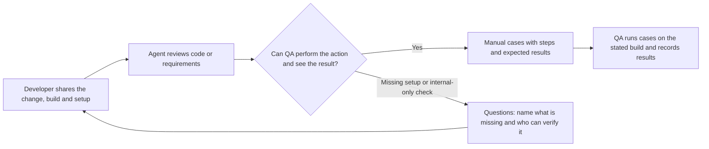

# Manual QA test cases

Turn a branch, feature, release handoff, or requirement into a short list of end-to-end cases a tester can run through the product.

## From developer to QA

1. **Developer** shares the branch or comparison, the intended build or environment, and any synthetic test setup.
2. **Agent** writes cases with visible expected results, a target for testing, and temporary IDs starting at `QA-001`. All cases start as **Not run**.
3. **QA** runs the cases in the product and records the results. The **Questions** section tells the developer which checks need technical verification or additional setup.

For example, if a save API starts rejecting duplicates and the app shows a conflict message, QA checks that message by saving through the app. If the only evidence is an HTTP response from a private endpoint, the handoff asks the developer to verify it. A version-only update can produce zero manual cases when there is no known user workflow to check.

## Try it

Copy this skill folder into your agent's skills directory, or ask the agent to read [SKILL.md](SKILL.md) and its two references.

> Use qa-test-cases to write manual cases for the checkout change on this branch. The target is web staging, build 96, with a synthetic customer account. Save Markdown and CSV to the QA handoff folder.

Markdown and CSV are the defaults. Request standalone HTML or a print-ready PDF when useful, and ask for the codebase theme if you want the export to match the feature under test. If the build is unknown, the handoff states the best available reference, such as a reviewed commit or spec revision, and asks which deployment to use when needed.

See the [case format](references/format.md) and [worked example](references/example.md).
